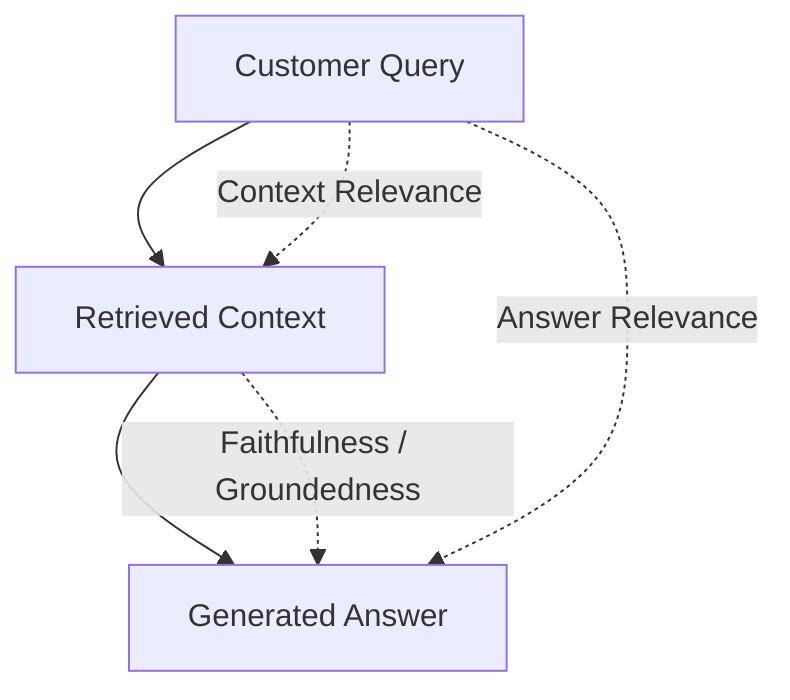

# RAG Evaluation Skill

This skill provides quantitative testing methods and benchmark frameworks to ensure chatbot accuracy and prevent regressions during updates.

---

## 1. The Core RAG Triad Metrics

To objectively score the chatbot, use the **RAG Triad** framework:



| Chỉ số (Metric) | Định nghĩa | Ngưỡng đạt chuẩn (Production Target) |
| :--- | :--- | :--- |
| **Faithfulness** (Độ trung thực) | Tỷ lệ luận điểm trong câu trả lời có thể suy luận trực tiếp từ tài liệu tìm được (đo lường Hallucination). | **$\ge 0.92$** |
| **Answer Relevance** (Độ liên quan) | Câu trả lời có giải quyết trúng và đúng câu hỏi của khách hàng hay không. | **$\ge 0.88$** |
| **Context Recall** (Độ phủ tài liệu) | Tài liệu tìm được có chứa tất cả các dữ kiện cần thiết để trả lời câu hỏi không. | **$\ge 0.85$** |
| **Context Precision** (Độ chính xác truy xuất) | Các đoạn tài liệu liên quan có được xếp hạng ở đầu (Top 1-3) thay vì nằm ở cuối không. | **$\ge 0.85$** |

---

## 2. Xây Dựng "Golden QA Dataset"

Trước khi Go-Live, doanh nghiệp phải có tối thiểu **50 – 100 cặp câu hỏi - đáp chuẩn**:
* **30% FAQ phổ biến:** Thời gian mở cửa, địa chỉ showroom, bảng giá cơ bản, hotline.
* **30% Tình huống phức tạp:** Điều kiện bảo hành có ngoại lệ, chính sách đổi trả hàng đã dùng thử, điều khoản thanh toán trả góp.
* **20% Câu hỏi bẫy / Không có trong tài liệu:** Hỏi về sản phẩm đối thủ, hỏi chính sách mà công ty không có $\rightarrow$ Kiểm tra xem bot có biết từ chối lịch sự hay bịa thông tin.
* **20% Câu hỏi hội thoại nhiều lượt (Multi-turn):** Khách hỏi theo kiểu ngữ cảnh (VD: *"Áo này bao nhiêu tiền?"* $\rightarrow$ *"Thế có màu đen không?"*).

### Cấu trúc file Dataset mẫu (`golden_dataset.json`):
```json
[
  {
    "id": "qa_001",
    "query": "Tôi muốn đổi áo do mặc chật thì công ty có hỗ trợ không?",
    "ground_truth": "Công ty hỗ trợ đổi size miễn phí trong vòng 7 ngày kể từ khi nhận hàng với điều kiện sản phẩm còn nguyên tem mác và chưa qua giặt tẩy.",
    "expected_source": "chinh-sach-doi-tra-2026.pdf"
  }
]
```

---

## 3. Script Đánh Giá Tự Động Với Python & Ragas

```python
# test_rag_evaluation.py
import pytest
from ragas import evaluate
from ragas.metrics import faithfulness, answer_relevancy, context_precision
from datasets import Dataset

def run_rag_eval(test_cases: list[dict]):
    """
    test_cases format:
    [
        {
            "question": "...",
            "contexts": ["...chunk 1...", "...chunk 2..."],
            "answer": "...bot answer...",
            "ground_truth": "..."
        }
    ]
    """
    dataset = Dataset.from_list(test_cases)
    results = evaluate(
        dataset,
        metrics=[faithfulness, answer_relevancy, context_precision]
    )
    
    print("Evaluation Results:", results)
    
    # Enforce quality gates
    assert results["faithfulness"] >= 0.90, "Faithfulness failed threshold!"
    assert results["answer_relevancy"] >= 0.85, "Answer Relevancy failed threshold!"
    return results
```

---

## 4. Feedback Loop & Giám Sát Real-time (Langfuse)

1. **Gắn nút Like / Dislike** trên giao diện Web Chat Widget.
2. Khi khách bấm **Dislike**, tự động gắn tag `flagged_feedback` và đẩy cuộc hội thoại vào hàng chờ duyệt của Admin.
3. Hàng tuần, đội ngũ CSKH xem lại các câu trả lời bị Dislike:
   * Nếu do thiếu dữ liệu: Bổ sung vào Knowledge Base.
   * Nếu do bot diễn đạt sai: Cập nhật prompt hoặc fine-tune reranker.
