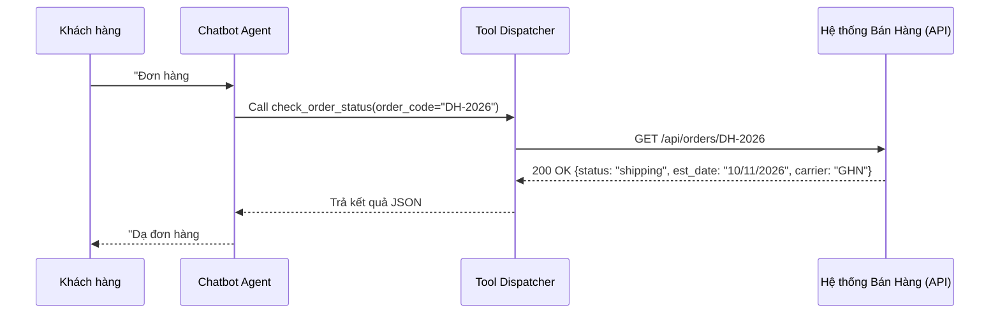

# Tool Calling Agent Skill

This skill guides the implementation of function calling, allowing the chatbot to act as an autonomous business assistant capable of taking actions and fetching live data.

---

## 1. Tool Calling Architecture



---

## 2. Quy Chuẩn Khai Báo Tools (Pydantic Schema)

Mỗi tool cần định nghĩa rõ ràng:
* **Tên hàm (Function Name):** Đặt tên dạng `động_từ_danh_từ` rõ nghĩa.
* **Mô tả (Description):** Mô tả cực kỳ chi tiết **khi nào** LLM nên gọi tool này.
* **Tham số (Arguments):** Khai báo kiểu dữ liệu, bắt buộc hay tùy chọn, kèm ví dụ cụ thể.

### Code mẫu Python:
```python
from pydantic import BaseModel, Field
from typing import Optional

class CheckOrderStatusInput(BaseModel):
    order_code: str = Field(
        ...,
        description="Mã đơn hàng khách hàng cung cấp, thường có tiền tố DH- hoặc dạng số, ví dụ 'DH-8821' hoặc '8821'."
    )
    phone_number: Optional[str] = Field(
        None,
        description="Số điện thoại đặt hàng của khách hàng nếu khách cung cấp để xác thực bảo mật."
    )

class CheckProductStockInput(BaseModel):
    product_name: str = Field(
        ...,
        description="Tên sản phẩm khách muốn hỏi, ví dụ 'áo sơ mi slimfit', 'giày chạy bộ nam'."
    )
    size: Optional[str] = Field(None, description="Kích cỡ nếu có (S, M, L, XL, 40, 41...).")
    color: Optional[str] = Field(None, description="Màu sắc nếu có (đen, trắng, be...).")

class CaptureSalesLeadInput(BaseModel):
    customer_name: str = Field(..., description="Họ và tên của khách hàng.")
    phone_number: str = Field(..., description="Số điện thoại hợp lệ (10 số) để nhân viên liên hệ tư vấn.")
    note: Optional[str] = Field(None, description="Ghi chú về nhu cầu tư vấn hoặc sản phẩm khách quan tâm.")
```

---

## 3. Tool Dispatcher & Safe Execution

```python
import httpx
import logging

logger = logging.getLogger(__name__)

async def dispatch_tool(tool_name: str, arguments: dict) -> str:
    """Điều phối và thực thi tool an toàn"""
    try:
        if tool_name == "check_order_status":
            order_code = arguments["order_code"]
            async with httpx.AsyncClient(timeout=5.0) as client:
                res = await client.get(f"https://api.sales.domain/v1/orders/{order_code}")
                if res.status_code == 200:
                    return res.text
                elif res.status_code == 404:
                    return f"Không tìm thấy đơn hàng {order_code}. Vui lòng kiểm tra lại mã đơn."
                else:
                    return "Hệ thống tra cứu đơn hàng đang bảo trì. Vui lòng thử lại sau ít phút."
                    
        elif tool_name == "check_product_stock":
            # Gọi API tồn kho
            ...
            
        elif tool_name == "capture_sales_lead":
            # Lưu thông tin khách hàng vào CRM
            ...
            
        else:
            return f"Công cụ {tool_name} không tồn tại."
            
    except httpx.TimeoutException:
        logger.error(f"Timeout khi gọi tool {tool_name}")
        return "Kết nối tới hệ thống bán hàng bị chậm, vui lòng thử lại sau ít phút."
    except Exception as e:
        logger.error(f"Lỗi thực thi tool {tool_name}: {e}")
        return "Có lỗi kỹ thuật khi tra cứu dữ liệu. Vui lòng liên hệ nhân viên tư vấn."
```

---

## 4. Nguyên Tắc An Toàn Khi Gọi Tool
1. **Chỉ dùng Read-Only API cho giai đoạn 1:** Chỉ cho bot đọc trạng thái đơn, tồn kho. Không cho bot quyền hủy đơn hay sửa đổi dữ liệu tài chính mà không có xác thực OTP.
2. **Không tin tưởng tuyệt đối input từ user:** Luôn validate mã đơn, định dạng số điện thoại trước khi đẩy qua hệ thống bán hàng để tránh SQL Injection hoặc lỗi ứng dụng.
